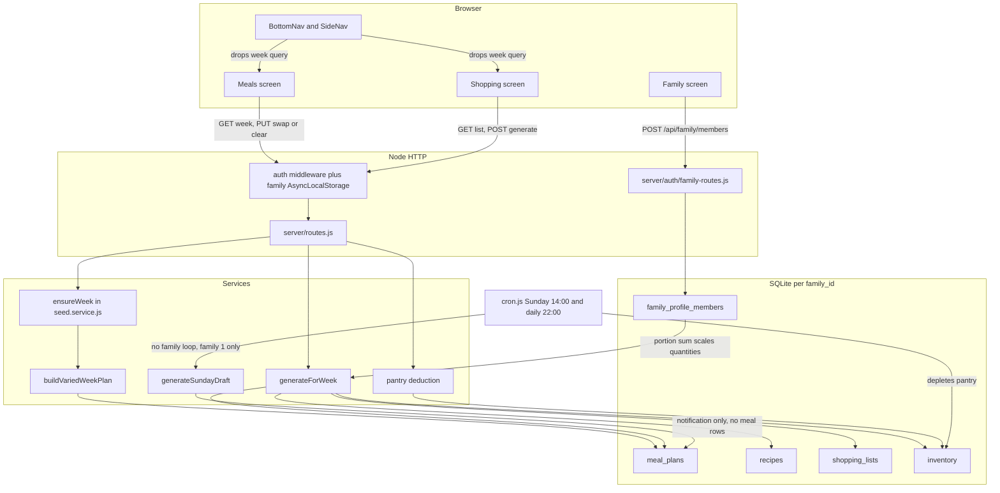

# Audit 2026-11 — planning, dinners, and what to ship next

**Date:** 2026-11-14
**Repo state:** `main` at `7fe6784` (PR #239). Live site: hverdagsplanleggeren.com. Deploy: Docker image on GHCR, Portainer on a Raspberry Pi.
**This document only.** No application code was changed.

## For the owner (plain language)

The app already has a real week planner, a recipe picker, a way to say "no dinner" on a day that already has a meal, and a shopping list that can be built from that week. Three things still get in the way of a normal Sunday planning session:

1. **An empty day cannot be finished.** If a day has no dinner yet, the only button is "plan a dinner". The shopping list refuses to build until every day is decided, including days you simply will not cook. You have to pick a recipe and then remove it.
2. **Next week and the shopping list do not stay together.** The meals screen has arrows for last week and next week. The buttons along the bottom (Home, Chores, Meals, Shopping, Calendar) forget which week you were on and jump back to this week.
3. **The pantry can be reduced twice for the same dinner**, and a day you cleared can still be reduced at 22:00. The nightly job also only sees family number 1. If this household is not family 1, that job is quietly editing the wrong pantry. This checkout cannot see the live database, so that last point is a risk to check, not a confirmed production incident.

Week navigation (always 7 days, no made-up past weeks) is **already on main**. PR #226 was merged on 2026-10-16. Do not revive, rebase, or reopen it.

---

## 0. How this audit was made

Read from the checkout, not from memory of older sprints: the meals and shopping screens, `server/routes.js`, seed and shopping services, family membership, cron, CI, and the GitHub pull requests named below. `node --check server/routes.js` and `node --check server/cron.js` both exited 0 on this commit, so `routes.js` is not in the corrupted state that caused the #223 revert.

**Not done:** no click-through on hverdagsplanleggeren.com, no phone, no production database. Anything that depends on the live family id, or on how a screen feels in the hand, is marked as a guess.

**Repo rule this file breaks:** `tests/phase21-repo-hygiene.test.js` allows only four markdown files directly under `docs/` (`ARCHITECTURE.md`, `BRAND_SYSTEM.md`, `DB_INDEXES.md`, `DOMAIN_MODEL.md`), asserted at lines 123–128. This file was placed here because the request asked for `docs/AUDIT-2026-11.md` and for no other file. The policy test will fail until that whitelist gains this name. Subfolders such as `docs/analyses/` are exempt; that was the alternative location.

### History that matters

| PR | State on 2026-11-14 | What to do |
|---|---|---|
| [#221](https://github.com/ChristerFrestad/FamilyAssistant/pull/221) | Merged 2026-09-24. `Add member` creates a roster row (name, category, portion size). No email, no login. | Leave it. Fix validation in backlog item 10. |
| [#223](https://github.com/ChristerFrestad/FamilyAssistant/pull/223) | Merged, then reverted. | Do not resurrect the branch. The revert is [#224](https://github.com/ChristerFrestad/FamilyAssistant/pull/224), commit `0fed846`, because a per-file upload corrupted `server/routes.js`. The PR itself deleted thousands of lines. |
| [#226](https://github.com/ChristerFrestad/FamilyAssistant/pull/226) | **Merged 2026-10-16**, merge commit `f5198f1`, title "week navigation (re-land #223) + always 7 days + no fabricated past weeks". | **Closed and done.** Do not revive or rebase. Follow-ups that are still open in code are listed below (week lost in the main nav, past-week API writes, Oslo vs UTC). The stale meals cache it warned about was fixed later in #239 (`NetworkFirst` in `client/vite.config.ts` lines 135–140). |
| [#222](https://github.com/ChristerFrestad/FamilyAssistant/pull/222) | Still **open**: docs-only note for #221. Diff not reviewed here. | Read it before writing another family-docs PR, so the two do not collide. |
| [#239](https://github.com/ChristerFrestad/FamilyAssistant/pull/239) | Merged, current `HEAD`. | Already fixed: delete a chore, open a recipe from the week list, remove a planned dinner, first swap no longer paints a stale week, new weeks rotate the family's own recipes instead of repeating the seven seed dinners. Do not re-file those. |

Open pull requests besides #222 are dependency bumps (#208, #209, #210, #236, #240, #241). None of them is the week planner. Major bumps (`better-sqlite3` 13, Vite React plugin 6, jsdom 30) need a human yes before merge; they are outside this audit.

---

## 1. Architecture map

One Node process, one SQLite file, one React app built into `public/v2/` and served at `/`. `docs/ARCHITECTURE.md` is still the right one-page picture, with two drifts: it says routes contain no business logic (they do — week seeding, shopping autogen, Sunday-push), and it says there are 22 services (`docs/ARCHITECTURE.md` lines 84–89). `server/services/` currently has 32 JavaScript files.

### Layers

| Layer | Where | Role in planning and dinners |
|---|---|---|
| Screens | `client/src/app/screens/Meals.tsx`, `Shopping.tsx`, `Family.tsx`, `RecipeEditor.tsx` | What the family taps. Routes in `client/src/app/App.tsx` lines 129–154. |
| Week in the URL | `client/src/app/hooks/useSelectedWeek.ts`, `isoWeek.ts` | `?week=YYYY-WNN`. Omitted when it is the current week (`isoWeek.ts` lines 57–59). |
| HTTP | `server/index.js` boots DB, migrations, seed, then routes. `server/http/server.js` authenticates and opens the family scope. `server/routes.js` (3154 lines) wires meals, recipes, shopping, Sunday-push. Family routes live in `server/auth/family-routes.js`. |
| Rules | `server/services/seed.service.js` (`ensureWeek`), `meal-planning.service.js` (two different menu builders), `shopping-list.service.js`, `pantry-deduction.service.js`, `family.service.js` (portion scale) | |
| SQL | `server/repositories/*.js`. `server/repositories.js` is a 3-line re-export. Every read uses `getFamilyId()` from `server/auth/family-context.js`. |
| Clock jobs | `server/cron.js` | Sunday 14:00 menu suggestion, Monday chores, daily 22:00 pantry depletion. |
| Data | `meal_plans`, `recipes`, `recipe_ingredients`, `shopping_lists`, `shopping_list_items`, `inventory`, `family_profile_members`, `users`. Products catalog is global (no `family_id`). |

Multi-tenant rule, in one line: inside a request, `getFamilyId()` is the logged-in family. Outside a request (startup seed, most cron jobs) it falls back to **family 1** (`server/auth/family-context.js` lines 32 and 43–56). `weeklyChoresJob` was fixed to loop families (`server/cron.js` lines 127–138). Sunday-push, shelf-life, and depletion were not.

### Diagram

### Data model (the parts this flow touches)

Documented in `docs/DOMAIN_MODEL.md` lines 240–255 (`MealPlan week`). Code is the source of truth where the doc is thin (shopping lists are not a first-class entity there).

- **`meal_plans`**: one dinner per day. `day_of_week` 0 = Monday … 6 = Sunday. `recipe_id` NULL and `status = 'planned'` means "not decided". `removed` means "no dinner", on purpose. Also `away`, `skipped`, `cooked`. Unique per family, week, day, and meal type (migration 014).
- **`recipes` / `recipe_ingredients`**: per family. `optional` is a column (`server/migrations/001_initial_schema.sql` line 58). The shopping math never reads it (section 4).
- **`shopping_lists` / `shopping_list_items`**: one active list per family per ISO week. Generating again merges; bought rows and hand-added rows are kept (`server/services/shopping-list.service.js` lines 403–439).
- **`family_profile_members`**: the roster from PR #221. These people have no user account. Their portion factors change how much food the list asks for (`shopping-list.service.js` lines 71–85).
- **`users`**: people who can log in. Separate from the roster.

No new migration is required for the backlog in section 5. Items that would need one are called out there.

### Key flows

**Open a week.** `GET /api/meals/week/:weekYear` (`server/routes.js` lines 568–582) calls `ensureWeek`. Future or current weeks with no rows are **written** as seven dinners (`seed.service.js` lines 309–324) using `buildVariedWeekPlan` (`meal-planning.service.js` lines 455+). A past week that was never stored is not written; the response sets `readOnly: true` (`routes.js` lines 579–581). The client hides the planner and shows a message (`Meals.tsx` lines 225–231).

**Change a dinner.** `PUT /api/meals/swap` and `PUT /api/meals/clear` (`routes.js` lines 594–634). Both return the full week so the screen does not wait for a cached GET. Both may auto-build the shopping list when the week is complete (`maybeAutogenerateShoppingList`, lines 198–211). The client ignores that field (section 2).

**Shopping list.** `POST /api/shopping/generate` calls `generateForWeek`, which throws `WEEK_NOT_COMPLETE` unless all seven days are decided (`shopping-list.service.js` lines 403–409, rule in `meal.repo.js` lines 172–195). The list screen reads the same `?week=` (`Shopping.tsx` line 69).

**Family member.** `POST /api/family/members` (`family-routes.js` lines 194–207 and 794). Roster only.

**Two menu machines, not one.** Opening next week in the UI fills `meal_plans` via `buildVariedWeekPlan`. The Sunday cron (`cron.js` lines 33–49) uses a different function, `generateSundayDraft`, and only if that week has **no** rows yet. It saves a draft and a notification. The SPA never reads `/api/notifications` (no matches under `client/src`). So the family sees the menu from the first time someone opens the week, and they never see the Sunday notification. `GET /api/sunday-push` (`routes.js` lines 2465–2470) is a third path: it **writes** the draft into `meal_plans` as a side effect of a GET. The SPA does not call it. Do not delete the cron job; it is live. Do not treat the HTTP GET as harmless.

---

## 2. How a family actually plans dinner

Dinner in this app is `meal_type: 'middag'` only. There is no lunch or breakfast plan.

### 2.1 This week

1. Open **Måltider** (`/meals`).
   1.1. `useSelectedWeek` picks the ISO week (`useSelectedWeek.ts` lines 37–41).
   1.2. The screen always asks for that week, not `/api/meals/current` (`client/src/app/meals/useMealsData.ts` is called with `weekYear` from `Meals.tsx` lines 55–66).
   1.3. The server returns seven slots keyed by `dayOfWeek` (`routes.js` lines 114–140). Missing rows are virtual (`id: null`) and are not saved.
2. Tap a day on the strip (`WeekStrip.tsx` lines 77–82) or in "Hele uka".
   2.1. The hero shows that day (`Meals.tsx` lines 381–390).
   2.2. A row that already has a recipe both selects the day **and** navigates to the recipe editor (`WeekList.tsx` lines 90–96). On a phone that leaves the planner. PR #239 did this because a tap that only selected the day looked like nothing when the hero sat above the fold (`docs/analyses/2026-11-03-meals-chores-week-menu.md`). The hero already has "Åpne oppskrift" (`MealHero.tsx` lines 195–203).
3. Empty day: one button, "Planlegg middag" (`MealHero.tsx` lines 120–136). That opens the recipe picker and `PUT /api/meals/swap`.
4. Day with a recipe: swap, open recipe, mark cooked, or "Ingen middag" (`MealHero.tsx` lines 173–214). "Ingen middag" calls `PUT /api/meals/clear` (`Meals.tsx` lines 114–127), which sets `removed` and drops the recipe.
5. There is **no** button for "borte" or "hopper over". Those statuses render if they are already in the database (`MealHero.tsx` lines 73–118) and the API accepts them (`schemas.js` lines 23 and 42–46, route at `routes.js` lines 637–648). The client never calls `/api/meals/status` or `/api/meals/reorder` (search of `client/src` for those paths: no matches).

### 2.2 Where it gets confusing or stuck

**Empty days block the shopping list, and the empty day has no "no dinner" button.** `isWeekComplete` is false while any day is `recipe_id` NULL and `status = 'planned'` (`meal.repo.js` lines 186–192). The empty hero only offers Plan (`MealHero.tsx` lines 120–136). "Ingen middag" is only rendered when a recipe is already set (lines 205–214). The practical path is: pick any recipe, then remove it. The shopping screen then says the week is not finished and sends you back (`Shopping.tsx` lines 208–223), without saying which days.

**The list may already have been built, and the meals screen does not say so.** When the seventh decision lands, `maybeAutogenerateShoppingList` writes the list (`routes.js` lines 198–211 and 603–612). Failures are swallowed (`catch` with no log, lines 209–210). The response field `autogeneratedShoppingList` is typed in `client/src/app/meals/mealsApi.ts` line 342 and is not read by the screen.

**Next week is filled in before anyone chooses.** The first GET of a future week inserts seven dinners (`seed.service.js` lines 317–321). With a normal library those days count as decided, so shopping **can** be generated without another tap. That is convenient and also surprising: the app picked the menu. Stored weeks are not rewritten (same function, the `exists` branch only backfills missing days). Whether a family wants a suggestion or a blank week is question 1 in section 6.

**The main navigation drops the week.** Meals and Shopping share `?week=` only when a link uses `pathWithWeek` (`Meals.tsx` lines 141–146, `Shopping.tsx` line 220). Bottom nav and side nav use a bare path (`nav-items.ts` lines 33–38, `BottomNav.tsx` line 79, `SideNav.tsx` line 53). From next week's menu, the Shopping tab opens **this** week's list. Shopping itself has no week arrows (the only `goPrevWeek` / `goNextWeek` in the app are in `Meals.tsx`).

**Marking cooked sticks if you dismiss the dialog.** `POST /api/meals/:id/mark-eaten` sets `cooked` before the dialog is confirmed (`routes.js` lines 754–757). Cancel calls unmark (`usePantryDeduction.ts` lines 128–143). The dialog's close path is `deduction.close` (`Meals.tsx` lines 263–279), which only clears local state (lines 145–147) and leaves the dinner cooked. The route comment (lines 720–735) says cancel is the undo. Backdrop or X is not cancel.

**Past weeks.** Browsing a week that was never planned shows a read-only card and writes nothing. That part of #226 is in place. A direct `PUT /api/meals/swap` on that week still inserts one row, because `ensureWeek` returns without writing and `setRecipe` then upserts (`seed.service.js` lines 297–300 says this on purpose). After that one write the week is no longer read-only.

**Week list hidden when every dinner is empty.** `allEmpty` replaces the seven rows with a generic card (`Meals.tsx` lines 356 and 413–417). The day strip remains. This shows up when the library has no safe recipes, not on a normal rotated week.

**"Åpne kilde"** goes to `recipe.url` (`MealHero.tsx` lines 215–224). Several seed URLs are site homepages, not the recipe. Observed in the #239 analysis; not re-checked against `server/seed.js` recipe by recipe in this pass.

### 2.3 Shopping, after the week is decided

1. Best path: "Åpne handleliste" on the meals header, which keeps `?week=`.
2. Risky path: the Shopping tab, which does not.
3. If no list exists, the empty state calls `POST /api/shopping/generate` for the week in the URL.
4. Ingredients are summed by product key or lowercased name (`shopping-list.service.js` lines 86–102). The same name in two units stays two lines (the key does not include `unit` on this first pass; the later fingerprint does, lines 310–315 in the same file). Pantry stock is subtracted (lines 109–116). Days marked away, skipped, or removed contribute nothing (lines 80–83).
5. Regenerating merges. Bought items stay bought.
6. There is no separate "next week shopping" job. Next week works only as "open that week and generate". The Sunday cron does not write a shopping list (section 1).

### 2.4 Family members in this flow

Adding a child from the Family screen (PR #221) does not create a login. It does change dinner quantities, because `effectiveScale` uses the roster (`shopping-list.service.js` lines 71–85). Invite remains a different, owner-only path. The route checks that `name` is present (`family-routes.js` lines 196–197) and the repository checks category and a numeric range (`family.repo.js` lines 187–194). The range check is `portionFactor < 0.1 || portionFactor > 2.0`. In JavaScript both comparisons are false for a non-numeric string, so the guard does not reject it. What SQLite then stores was not executed in this audit.

### 2.5 Accessibility and phone layout (planning screens)

Observed, not a full WCAG 2.2 audit:

- The week strip is a real set of buttons with `aria-pressed` (`WeekStrip.tsx` lines 77–81). The dot that means "dinner planned" is `aria-hidden` (lines 99–103), so a screen reader hears the weekday and not whether it is planned.
- The week title is a `
` (`Meals.tsx` lines 169–174). Nothing announces the new week after the arrows. The arrow buttons themselves have names (`weekNav.prevAria` / `nextAria`).
- Week arrows use `Button` `size="sm"` (lines 159–167). `docs/workflow/wcag-followups.md` MEDIUM-2 already flags small buttons against the 24px target in WCAG 2.2 (the follow-ups file still says 2.1; the target-size issue is the 2.2 one).
- Pantry badge contrast (MEDIUM-1 in the same follow-ups file) is unchanged and is outside the dinner planner.
- The day strip scrolls sideways (`WeekStrip.tsx` lines 66–71, `min-w-[72px]`). The old "page zoomed out" bug is described as fixed in code (`AppShell` `min-w-0`, this overflow). **Guess:** it holds on a phone. Not rechecked on a device in this run.
- Header links "Åpne handleliste" and "Åpne bibliotek" sit in one row (`Meals.tsx` lines 140–155) and will wrap on a narrow screen. Usable, cramped.

---

## 3. Technical debt that can be deleted

Only items with evidence. "No importer found" means a search of the tree named in the row, not a proof that no operator script calls it by hand.

### Safe to delete

| Item | Evidence it is unused or broken | Delete with |
|---|---|---|
| `scripts/extract-frontend.js` | Header says "Run once" and reads `public/index.html` (lines 13–20). That file is gone (Sprint 8; `docs/architecture/frontend.md`). Running it throws. | Also drop the `tsconfig.json` include at lines 38–39. Not referenced by `package.json` scripts. |
| `scripts/rewrite-index-html.js` | Same one-shot extract era. Only other git reference is the same `tsconfig.json` include (search of the repo). | Same PR as the extractor. |
| i18n key `meals.placeholder.description` | Text still says the meals screen is "coming in phase 2C" (`client/src/app/i18n/locales/no/meals.json` lines 110–112, and the English file). Search for `meals:placeholder` and `placeholder.description` under `client/`: no matches. | Both locale files. Tiny; fold into another meals PR rather than its own. |

### Do not delete (looks unused, is not)

| Item | Why it stays |
|---|---|
| `GET /api/sunday-push` and `generateSundayDraft` | Cron calls the service every Sunday 14:00 (`cron.js` lines 33–49 and 315). The HTTP GET is unused by the SPA and has a write side effect. Remove or neuter the GET later; keep the job until question 1 is answered. |
| `public/sw.js` | Tombstone that unregisters the old v1 worker (`public/sw.js` lines 1–12). Still doing a job for browsers that cached v1. |
| `sharp` | Used by `server/branding/png-renderer.js`. The Windows flake is real (section 4) and is not a reason to drop the dependency. |
| `CopyButton`, `Row`, `Stack` | Imported by dev preview and a11y tests. Unshipped in the production bundle because `client → dev` imports are blocked. Not dead. |
| Recipe suggestions, similar recipes, image import, feedback, LLM, receipts | No SPA caller found for several of these. Tests and operator tools may still hit them. Treat as "no v2 UI", not as proven dead, until each path is grepped through `tests/` in its own PR. |

### Duplicates (consolidate later, do not delete one blindly)

ISO week math exists in three places: `client/src/app/hooks/isoWeek.ts` (lines 14–20, comment says it matches server UTC), `server/routes.js` `previousIsoWeek` (lines 95–102), and `server/seed.js` `getWeekYear` (used by cron and `ensureCurrentWeek`). The client helper accepts any `YYYY-WNN` including `W99` (`isoWeek.ts` lines 6–7). The server also requires week 01–53 (`routes.js` lines 105–111). Unifying them is the timezone PR (backlog 12), not a deletion.

A comment block describing shopping auto-merge is attached to `previousIsoWeek` (`routes.js` lines 84–94). The function it describes starts at line 198. Fix the comment when that function is next edited. Do not move code just to move the comment.

### Oversized files

| File | Lines | Note |
|---|---|---|
| `server/routes.js` | 3154 | Valid syntax on this commit. History: a partial upload corrupted it and #224 reverted the result. **Do not split it in the first PRs.** A later extract of one group (meals, or Sunday-push) must replace the whole file in one commit and pass `node --check` plus the existing meals tests. |
| `server/seed.js` | 2389 | Product catalog plus `getWeekYear`. Not a runtime bug. Leave it until a catalog PR. |
| `client/src/app/screens/RecipeEditor.tsx` | 846 | Large screen. Split only when the next recipe change is already touching it. |
| `server/repositories/family.repo.js` | 608 | |
| `server/repositories/shopping.repo.js` | 541 | |

### Stale docs (fix in a docs PR, not by deleting history)

- `docs/workflow/known-issues.md` lines 9–20 still debug `public/js/meals.js`, which does not exist. The "similar recipes" buttons it describes are not in the React week list.
- `docs/ARCHITECTURE.md` understates route logic and the service count (section 1).
- `docs/workflow/wcag-followups.md` is still an accurate deferral list for pantry contrast and small buttons. It is stale only in naming WCAG 2.1 while target size is a 2.2 criterion.

### Scripts that look like one-offs and should stay

`scripts/cleanup-orphan-family-1.js`, `diagnose-orphans.js`, `repair-orphan-family-seed.js`, and the e2e tenant scripts are operational. Not deleted here. `scripts/db-check-pantry-bug.js` is not in `package.json`; it was not proven unused beyond that, so it is a candidate only.

---

## 4. Gaps and bugs

### Validation

- Meal swap, clear, status, and reorder use Zod (`routes.js` lines 594–667, schemas in `server/schemas.js`).
- Mark cooked / unmark check the id by hand and have no body schema (`routes.js` lines 738–801). The body is empty or an items list on apply-deduction, which does use Zod (lines 768–771). Low risk.
- `POST /api/family/members` and the matching PUT do not use Zod (`family-routes.js` lines 194–222). The portion-factor hole is in section 2.4. This is the live #221 path.
- Optional recipe ingredients are stored and then always shopped. The collect loop (`shopping-list.service.js` lines 86–102) has no `optional` check. Column: `001_initial_schema.sql` line 58.

### Error handling

- Shopping autogen on a meal save cannot fail the save, by design, and also cannot be seen: empty `catch` (`routes.js` lines 209–210). The family gets no list and no message.
- Adding a shopping row swallows pantry-resolver failure and inserts the line with no product key (`server/routes.js` lines 1434–1436). The line still appears. Worth a log, not a user-facing change.
- `GET /api/sunday-push` writes meal rows. A crawler or a retry can seed a week the family did not open. The SPA does not call it today.

### Dinner vs pantry (the sharp bug)

`dailyDepletionJob` (`cron.js` lines 92–118) runs at 22:00 (`cron.js` line 319). It skips `away` and `skipped` only (lines 98–99). It does **not** skip `removed` or `cooked`.

- A day cleared with "Ingen middag" can still lose pantry quantity that night.
- A dinner marked cooked, with ingredients already taken off in the dialog (`pantry-deduction.service.js` line 131, note `meal_deduction:<mealId>`), can be reduced again at 22:00. The two paths do not consult each other.

The same job calls `repos.mealPlans.getWeek` and `inventory.reduceQty` with no `runWithFamily`. Both use `getFamilyId()`, which is family 1 outside a request (`family-context.js` lines 43–56, `inventory.repo.js` lines 97–104). `sundayPushJob` and `shelfLifeCheckJob` have the same family-1 limit. `weeklyChoresJob` shows the fix (lines 127–138).

**Guess:** the household behind hverdagsplanleggeren.com might be family 1, in which case depletion does hit their pantry, including the double-count and the removed-day cases. If they are not family 1, the job edits an empty or orphan pantry and their real stock never moves at 22:00. Confirm with `SELECT id, name FROM families` on the Pi. Not done in this audit.

### Accessibility

See section 2.5. Additional known deferrals live in `docs/workflow/wcag-followups.md` (pantry badge contrast below 4.5:1, small button targets, portion slider label). Auth screens are called out of scope in `docs/runbooks/wcag-compliance.md`. This audit did not re-run axe or a contrast checker.

### Mobile

The planner is a single column with a horizontal day strip. No separate desktop layout. The main failure on a phone is behavioral (section 2.2): the shopping tab forgets the week, and a week-list tap leaves the screen. Layout overflow from April 2026 is addressed in the current strip CSS. Not verified on a device.

### Tests and CI

From `.github/workflows/ci.yml`:

- Pull requests run lint, format, typecheck, `npm test`, `typecheck:client`, client tests, and the client build on **Ubuntu, Node 20** (jobs around lines 65–89).
- Windows and macOS run only on push to `main` or the weekly schedule (lines 96–150). The Windows leg is Node 22 because `better-sqlite3` has no Node 20 prebuild there (comment at lines 105–109). That job runs lint, format, and `npm test`. It does **not** run `typecheck:client`.
- `tests/m-week8-typecheck.test.js` lines 25–28 spawn `tsc` directly because `npx.cmd` failed with `EINVAL` on Windows Node 24. That test runs inside `npm test`, so a Windows main-push does exercise server `tsc` through the workaround. Client `tsc` stays Linux-only.
- `tests/branding-png-endpoints.test.js` lines 99–120: sharp's first render on Windows GitHub runners has exceeded the per-test timeout (flakes noted 2026-09-24 and 2026-10-16). A 120s warmup was added. The dependency is still the fragile one; the warmup reduces the flake and does not remove it.
- Client flakes around chore completion and the recipe picker were patched in #234 and #235. Not re-run here.
- No `test.skip` was found in a repo search during exploration. That does not mean every assertion is strong; the week-complete rule is tested (`tests/meals-week-seed.test.js`), and the empty-day button gap is not, because the button does not exist.

`docs/ARCHITECTURE.md` says GET cache keys include `familyId`. That part is load-bearing. Meal mutations invalidate `meals`, `today`, and `shopping` (`routes.js` line 602). Trust that over adding another cache layer.

---

## 5. Backlog

Ordered by user value divided by risk. Each item is meant to be its own pull request, under about 400 changed lines, and shippable without the others. Planning and the dinner-to-list path come first, then deletions that cannot break a household. None of items 1–14 need a database migration.

Touch `server/routes.js` only in items 6, 11, and 13, and only as a small full-file edit. Do not upload it in pieces.

### 1. Let an empty day be "Ingen middag"

- **Goal:** A day with no recipe can be marked as no dinner, which is what the shopping rule already understands.
- **Files:** `client/src/app/components/meals/MealHero.tsx` (empty state, lines 120–136), `MealHero.test.tsx`, `client/src/app/screens/Meals.tsx` (handler already at lines 114–127), both `meals.json` locale files.
- **Acceptance:** On an empty day the hero shows Plan and "Ingen middag". The second calls `PUT /api/meals/clear`. The day comes back as `removed`. Planning again still works from the removed state (that button already exists, lines 91–106).
- **Test plan:** Component test for the new button. Screen test that a successful clear replaces the week from the response, same as a planned day. One server test already covers clear; do not duplicate it unless the client contract changes.
- **Risk:** Low. Uses an endpoint the planned-day button already calls. No migration.

### 2. Say which days are blocking the shopping list

- **Goal:** On the meals screen, if any day is still "not decided", name those days and scroll or select the first one. When every day is decided, say that the shopping list can be built and keep the existing link.
- **Files:** `Meals.tsx`, `meals.json` / `en/meals.json`, `Meals.test.tsx`. Decide "not decided" the same way as `meal.repo.js` lines 186–192: no recipe, and status not `away` / `skipped` / `removed`.
- **Acceptance:** Three unplanned days produce a message that lists them. Zero unplanned days produce no blocker. The shopping error card (`Shopping.tsx` lines 208–223) can stay; this stops the family from discovering the rule only after they switch screens.
- **Test plan:** Render meals with a mix of recipes, `removed`, and empty slots. Assert the day names. Assert the banner is absent when all seven are decided.
- **Risk:** Low. Copy and a derived list. Does not change the seven-day rule (question 2). No migration.

### 3. Keep the selected week in the main navigation, and show it on Shopping

- **Goal:** Choosing next week and then tapping Shopping opens that week's list. Shopping gets the same previous/next arrows as meals.
- **Files:** `client/src/app/components/layout/BottomNav.tsx` (link at line 79), `SideNav.tsx` (line 53), `nav-items.ts` only if the path should stay data and the query is applied at the link. `Shopping.tsx` header. Tests next to the nav components and `Shopping.test.tsx` if present.
- **Acceptance:** From `/meals?week=2026-W47`, the Shopping tab is `/shopping?week=2026-W47`. The current week still has no query string (`isoWeek.ts` lines 57–59). Arrows on Shopping change the same param. Deep links still work.
- **Test plan:** Nav test with a memory router and an initial `?week=`. Shopping test that the arrows call the same week helper.
- **Risk:** Low. URL only. Active-state matching must ignore the query (it already compares `pathname`, `BottomNav.tsx` lines 35–38). No migration.

### 4. Tapping a week row should stay on the planner

- **Goal:** A row selects that day and brings the hero into view. Opening the recipe stays on the hero button, which already exists.
- **Files:** `WeekList.tsx` lines 90–96, `Meals.tsx` (pass selection without navigation, scroll the hero), `WeekList.test.tsx`.
- **Acceptance:** Clicking a planned row does not change the URL to `/recipes/:id`. The hero shows that day. "Åpne oppskrift" still navigates. Empty rows still open the picker (`onSelectEmpty` is already wired, `Meals.tsx` line 431).
- **Test plan:** Update the #239 test that expected navigation. Add a test that the hero button still navigates.
- **Risk:** Medium-low. #239 made the row navigate because selection alone felt like a dead tap on a phone. Scrolling the hero into view is the part that must be real (`scrollIntoView` on the hero card), otherwise this brings the old bug back. No migration.

### 5. Tell the family when the shopping list was just created

- **Goal:** If swap or clear returns `autogeneratedShoppingList`, show a short confirmation with a link to that week's shopping list.
- **Files:** `useRecipePicker.ts`, `Meals.tsx` clear handler, locale files, existing picker tests.
- **Acceptance:** A non-null autogen payload shows a status message and `pathWithWeek('/shopping')`. Null shows nothing. A swallowed server error still shows nothing (backlog 13 makes that visible in logs).
- **Test plan:** Mock `swapMeal` with a list id and assert the link. Mock null and assert no link.
- **Risk:** Low. No migration.

### 6. "Borte" on a day

- **Goal:** From the hero, mark a day as eating out, and undo it. The shopping math already ignores `away` (`shopping-list.service.js` lines 80–83).
- **Files:** `client/src/app/meals/mealsApi.ts` (new `setMealStatus`), `MealHero.tsx`, `Meals.tsx`, locales, tests. `server/routes.js` status handler (lines 637–648) should return `week` the same way swap does, so the screen does not refetch a stale plan. That is the only server edit.
- **Acceptance:** "Borte" sends `{ weekYear, dayOfWeek, status: 'away' }`. The hero shows the away card. A way back sets `planned` or clears, and a dinner can be chosen again. Child role still gets 403 (`requireRole('adult')` is already on the route).
- **Test plan:** Client test for the request body. One route test that the JSON includes `week`. Do not add `skipped` in this PR; one status is enough.
- **Risk:** Low, with a small `routes.js` edit. No migration. Operator approval applies because this is a `feat/` change (`AGENTS.md` DEL 5.3), not because of the auth freeze. The route is not under `server/auth/`.

### 7. Delete the broken one-shot frontend scripts

- **Goal:** Remove tools that crash on today's tree.
- **Files:** `scripts/extract-frontend.js`, `scripts/rewrite-index-html.js`, `tsconfig.json` lines 38–39.
- **Acceptance:** Both files gone. `npm run typecheck` passes. `package.json` has no script pointing at them (it does not today).
- **Test plan:** `npm run typecheck`. No new test; the files have no remaining caller.
- **Risk:** Low. No migration. Confirm with `git grep extract-frontend` before deleting; this audit found only `tsconfig.json`.

### 8. Closing the cook dialog without a choice undoes the cooked mark

- **Goal:** Backdrop and X behave like Cancel (unmark) until the person confirms a deduction or explicitly skips it.
- **Files:** `Meals.tsx` lines 263–279, `usePantryDeduction.ts` lines 123–147, the dialog component if close and cancel are different buttons, their tests.
- **Acceptance:** Open "Marker tilberedt", dismiss the dialog, dinner status is `planned` again. Confirm still applies pantry changes and leaves `cooked`. "Skip trekk" still leaves `cooked` and does not change the pantry (current `skip`, lines 123–126).
- **Test plan:** Hook test: `close` before confirm calls `unmarkMealEaten`. `skip` does not.
- **Risk:** Low. Matches the comment on the route (lines 732–735). No migration.

### 9. Nightly pantry job: every family, and do not deduct a cleared dinner

- **Goal:** Depletion, Sunday-push, and shelf-life run inside `runWithFamily` for each family id, copying `weeklyChoresJob`. Depletion skips `removed`. Depletion skips an ingredient that already has an inventory-log note `meal_deduction:<mealId>` for that dinner.
- **Files:** `server/cron.js` (`sundayPushJob` lines 33–49, `dailyDepletionJob` lines 92–125, `shelfLifeCheckJob`, `startCronJobs`). A repository read for the deduction note if one does not already exist. Tests beside the existing cron tests.
- **Acceptance:** Two families in a test database both get a Sunday notification when next week is empty, and both get depletion for tonight's dinner. A `removed` slot does not change inventory. A slot already deducted through the dialog is not reduced a second time. Family 1 is no longer the silent default.
- **Test plan:** Extend the cron test with two family ids. Assert inventory quantities for removed, cooked-with-log, and planned-not-cooked.
- **Risk:** Medium. This changes pantry numbers on the Pi the next night after deploy. The behavior change is "stop deducting the wrong things", which is the point. Read the live `families` table before merging so the operator knows whether tonight's job has been hitting their data. No migration. Do not add a column; the deduction note already exists.

### 10. Validate roster members with Zod

- **Goal:** `POST` and `PUT /api/family/members` reject a bad portion factor, a bad category, and an empty or huge name before any insert.
- **Files:** `server/schemas.js`, `server/auth/family-routes.js` lines 194–222, a test next to the existing family route tests. The React modal can stay; it already sends sensible values.
- **Acceptance:** `portionFactor: "abc"` returns 400 and inserts nothing. `1.0` still works. Category outside `adult|teen|child` returns 400. Name required, max length aligned with the family-name cap already used nearby (100) unless the repository has a tighter limit — check `family.repo.js` before picking the number.
- **Test plan:** HTTP test for the three rejects and one accept. Assert row count.
- **Risk:** Low. This is `server/auth/` (soft-thaw, `AGENTS.md` DEL 6.1b): open the PR, do not merge it without an explicit yes. No migration.

### 11. Do not invent a past week through the API

- **Goal:** `swap`, `clear`, `status`, and `reorder` return 400 when the week is past **and** has no stored rows. Stored past weeks stay as they are (the screen already lets you edit those, because `readOnly` is only for an empty past week).
- **Files:** `server/routes.js` meal mutations, `tests/meals-week-seed.test.js`.
- **Acceptance:** `PUT /api/meals/swap` on an unseen past week writes zero `meal_plans` rows and returns 400. The same call on a past week that already has rows still updates that day. GET behavior is unchanged.
- **Test plan:** Add to `tests/meals-week-seed.test.js`, which already covers the GET side of F2.
- **Risk:** Low. Small `routes.js` change. No migration.

### 12. One clock for "this week"

- **Goal:** The current ISO week is Europe/Oslo everywhere: the SPA (`isoWeek.ts` lines 1–3 and 14–20), `seed.getWeekYear`, `ensureCurrentWeek` (`seed.service.js` lines 209–215 and 331–332), `/api/today`, and cron.
- **Files:** those, plus `tests/meals-week-seed.test.js` (it already has a Monday 00:30 case).
- **Acceptance:** A fixed timestamp of Monday 00:30 Europe/Oslo is the new week on the client and on `ensureCurrentWeek`. Sunday 23:30 Oslo is still the previous week. UTC-only callers do not drift between 00:00 and 02:00 Oslo.
- **Test plan:** Table of instants in the existing week-seed test. No production data rewrite: this does not move stored `week_year` values.
- **Risk:** Medium. Wrong by one week if the zone math is off. Ship after items 1–3. No migration.

### 13. Log shopping autogen failures

- **Goal:** The empty `catch` in `maybeAutogenerateShoppingList` (`routes.js` lines 209–210) logs with `server/logger.js` and still returns null, so a meal save never fails because of the list.
- **Files:** `server/routes.js`, a unit or route test that forces `generateForWeek` to throw and asserts the meal response is still `ok: true`.
- **Acceptance:** Meal swap succeeds. A log line includes the week and the error code. No stack traces to the browser.
- **Risk:** Low. No migration.

### 14. Planner accessibility, small

- **Goal:** The week title is an `aria-live` region so the arrows announce the new week. Each day button's accessible name includes whether a dinner is planned (the dot can stay visual).
- **Files:** `Meals.tsx` lines 169–174, `WeekStrip.tsx` lines 77–103, locale strings, the existing meals a11y test.
- **Acceptance:** The button name is not only "Man". axe run on the meals screen still passes.
- **Risk:** Low. No migration.

### Later, not in the first batch

- **Optional ingredients.** Skip `optional = 1` in `computeShoppingListForWeek`, or show them as "kan sløyfes" and do not count them in `needsBuy`. Behavior change for every existing list the next time someone regenerates. Recommend skip. No migration. Do it after the owner has used item 1, so list changes are not mixed with the completeness fix.
- **Stale docs** from section 3. Docs-only PR. No migration.
- **WCAG follow-ups** already written down (pantry contrast, `size="sm"` targets). The week arrows in item 14 can bump those two buttons to the default size in the same PR if it still fits in 400 lines; otherwise a separate PR.
- **Splitting `server/routes.js`.** Not until the dinner fixes above are in. One route group per PR, whole-file commit, `node --check`, meals tests. The #223 corruption is the reason for that discipline.
- **Neutering `GET /api/sunday-push`.** It writes data on read (`routes.js` lines 2465–2470). After question 1, either make the GET read-only or remove it. The cron job stays until then.
- **White-label in the PWA manifest.** `client/vite.config.ts` lines 42–44 hardcode the name "FamilyAssistant" while the rest of the product can be overridden (`AGENTS.md` DEL 7.12). Real for other installs, invisible if this deploy's built name is already Husby via env. Check the built manifest before prioritizing. No migration.

### Explicitly not recommended

- Reviving PR #226 or the `feat/meals-week-navigation-v2` branch. The work is on `main`.
- A database migration for any item above. A `deducted_at` column is unnecessary while the `meal_deduction:` log note exists.
- Deleting LLM, receipt, or feedback routes in a drive-by. No v2 button is not the same as unused.
- Merging the open major dependency PRs as part of this cleanup.

---

## 6. Questions only the owner can answer

Three, and then implementation can proceed on items 1–4 without the answers.

1. **When you open a week that has never been planned, what should be there?**
   Today the app fills seven dinners from your own recipes, rotated so it is not the same week again (`seed.service.js` lines 251–264). The other choice is seven empty days and you pick each one. Recommendation: keep the suggestion, and make it obvious ("Forslag — bytt det du vil") plus items 1 and 2 so a wrong suggestion is easy to clear. A blank week is quieter and slower every Sunday.

2. **May the shopping list be built from the dinners you have chosen so far, or only when all seven days are decided?**
   Today it waits for all seven (`meal.repo.js` lines 172–195). Recommendation: keep the rule until item 1 ships, because "no dinner" will then be one tap and the rule stops being a trap. If that still feels like homework, the next change is to generate from decided days only and leave undecided days off the list. That is a bigger behavior change and should be its own PR after you have tried item 1.

3. **Who is a family member?**
   "Add member" (live since #221) is a name on the roster. They have no login. They do change how much food is bought. Invite is a different button and creates an account. Recommendation: keep both, and on the Add dialog say in one sentence that this person does not get a login and that their portion size changes the shopping list. If every person should have their own login, stop adding roster-only people and we should not build more features on that path.

---

## Verification limits

- GitHub: #221 merged, #223 merged then reverted by #224, #226 merged, #222 still open, #239 is `HEAD`.
- `node --check` passed for `server/routes.js` and `server/cron.js`.
- No browser session, no Portainer, no production SQLite.
- Line numbers refer to `7fe6784`.
